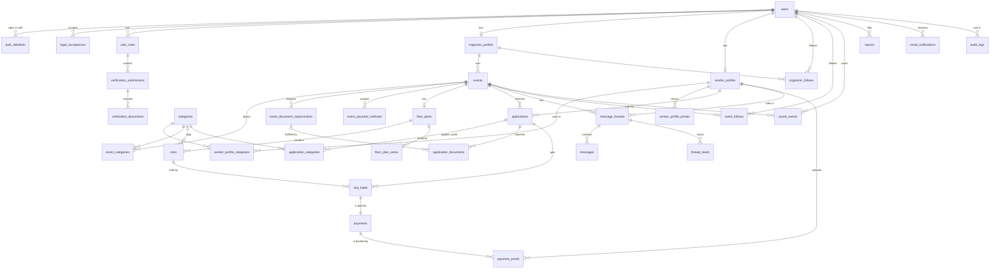
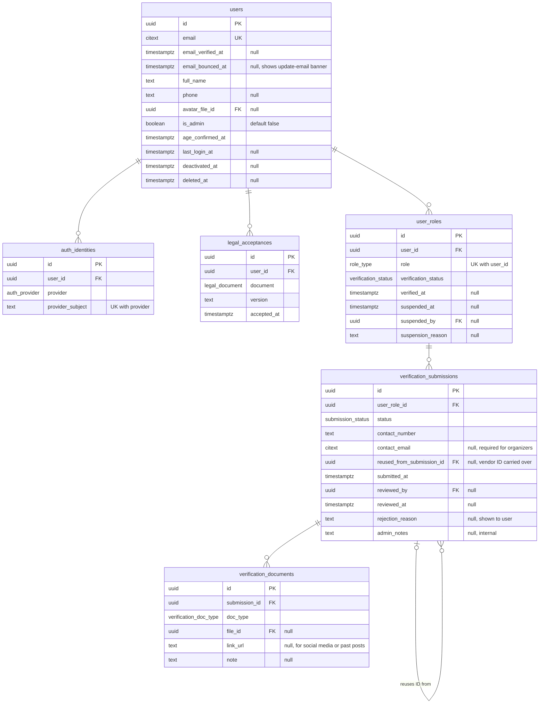
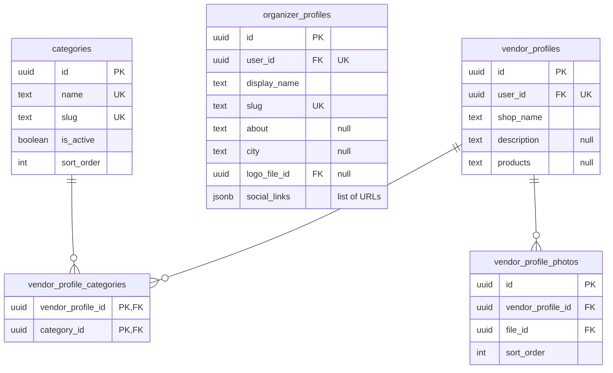
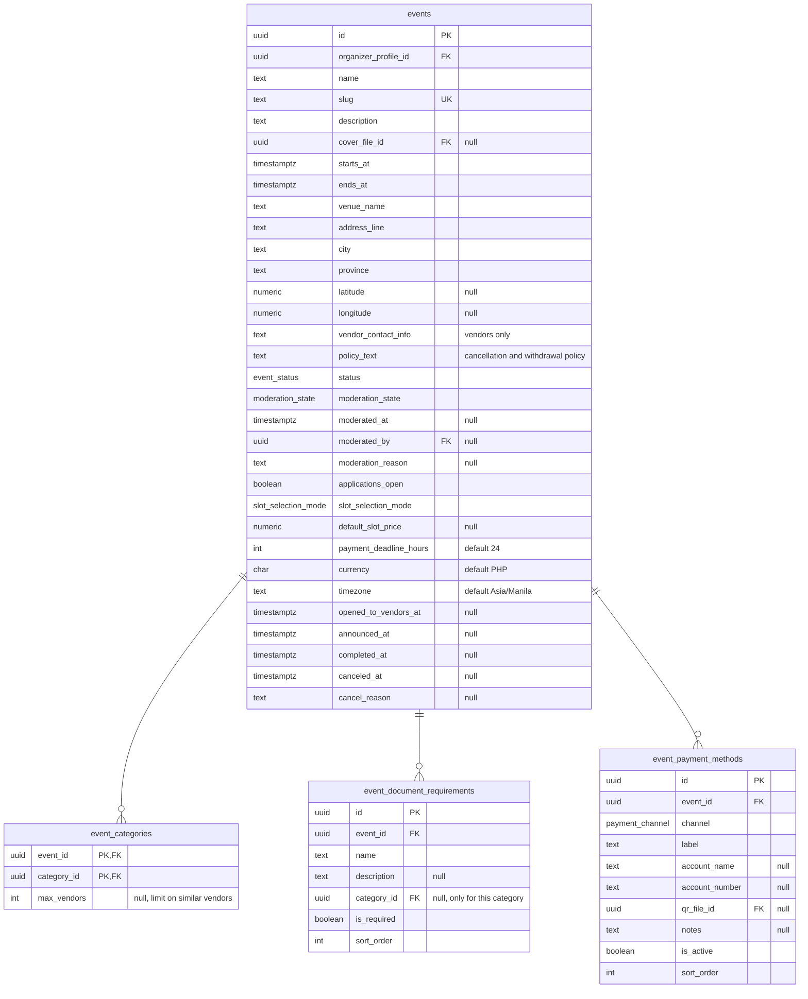
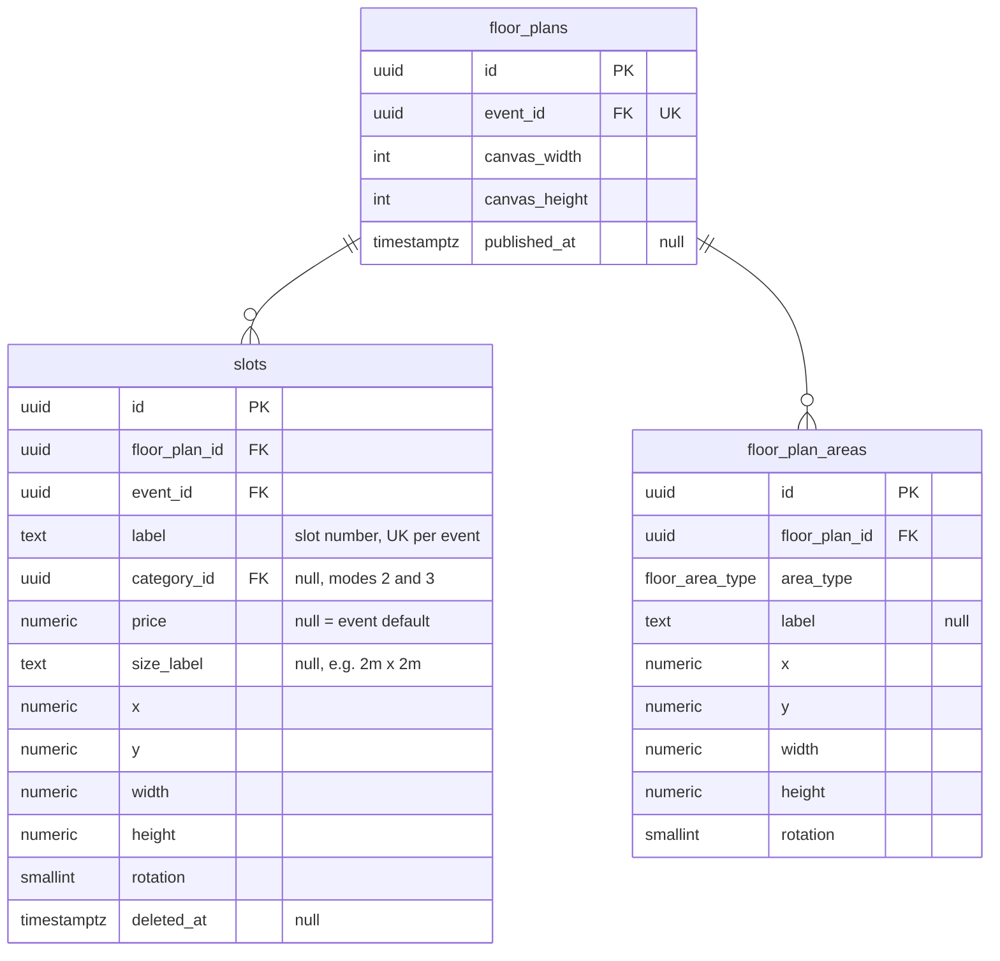
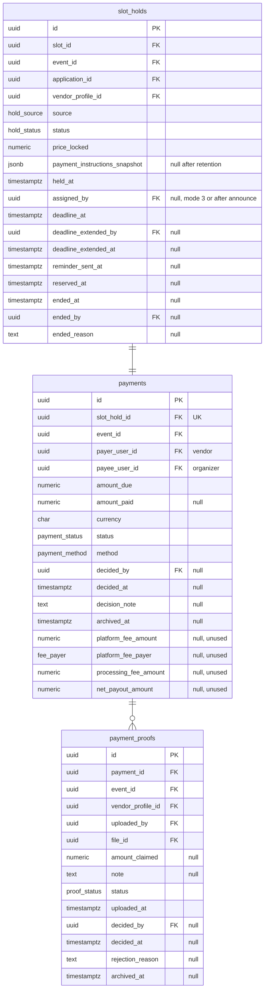
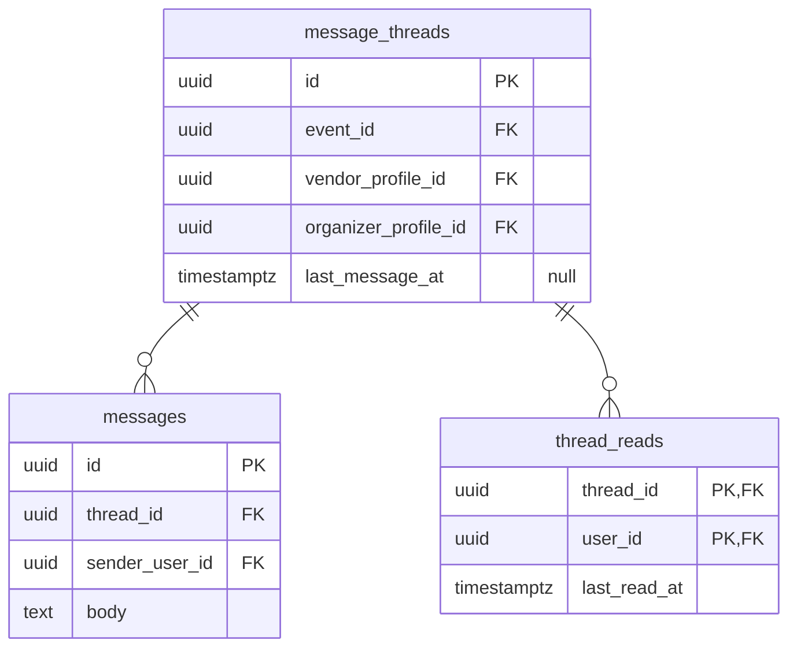

# Creavent MVP Data Model

**Status:** First draft. Logical model with PostgreSQL-style types. It follows the [Feature specification](feature-specification.md) and the [User flows](user-flows.md). If this file and the spec disagree, the spec wins.

Last updated: 2026-11-12

## Contents

1. [Conventions](#1-conventions)
2. [Decisions this model uses](#2-decisions-this-model-uses)
3. [ERD overview](#3-erd-overview)
4. [Enums (statuses and types)](#4-enums-statuses-and-types)
5. [Entities and attributes](#5-entities-and-attributes)
6. [Rules enforced by the data](#6-rules-enforced-by-the-data)
7. [Derived values](#7-derived-values)
8. [Retention and archiving](#8-retention-and-archiving)
9. [Decisions on questions this model raised](#9-decisions-on-questions-this-model-raised)

## 1. Conventions

- Every table has `id uuid` as its primary key, except join tables, which use a composite key.
- Every table has `created_at timestamptz` and, where rows change, `updated_at timestamptz`. These two columns are left out of the attribute tables below to keep them short.
- All times are stored as `timestamptz` (UTC). The app shows them in Asia/Manila.
- Money is `numeric(10,2)` in PHP. A `currency char(3)` column defaults to `PHP` so other currencies can be added later.
- Emails use `citext` so matching ignores case.
- Status columns use PostgreSQL enums (section 4).
- Rows that people may need as records are not hard-deleted. They change status (for example, a released hold) or get `deleted_at` / `archived_at`.
- Key: **PK** primary key, **FK** foreign key, **UK** unique, **null** = optional.

## 2. Decisions this model uses

These were agreed on 2026-11-11 while writing this model. A6 is resolved in [Open questions](open-questions.md) and written into the spec (§6.3).

| Topic | Decision | Where in the model |
|---|---|---|
| Product categories | One platform-wide list maintained by admins. Vendors, events, and slots all pick from it. | `categories` |
| One slot per vendor | A vendor can hold or reserve only one slot per event (for now), so each proof belongs to exactly one payment. | partial UK on `slot_holds`, `payment_proofs.payment_id` |
| A6: cash or payment without proof | The organizer can approve a payment without a proof image, with a note (for example, cash on site). | `payments.method`, `payments.decision_note` |
| Event policy | Free text, one per event, so it is a column on `events` rather than its own table. The text the vendor accepted is copied onto their application. | `events.policy_text`, `applications.policy_text_snapshot` |
| Attendee role | Any signed-in user is an attendee. Only vendor and organizer are stored as roles. Admins are a flag on the user. | `user_roles`, `users.is_admin` |
| Slot status | Not stored on the slot. It is worked out from the slot's active hold, so it can never disagree with the hold. | `slot_holds`, view in section 7 |

## 3. ERD overview

The overview shows entities and relationships only. Each area in section 5 has its own diagram with attributes. `files` is referenced by many tables and is left out of the overview to keep it readable.

## 4. Enums (statuses and types)

| Enum | Values | Spec |
|---|---|---|
| `role_type` | `vendor`, `organizer` | §1 |
| `verification_status` | `unverified`, `pending_review`, `verified`, `rejected` | §2.1 |
| `submission_status` | `pending_review`, `approved`, `rejected` | §2.1 |
| `verification_doc_type` | `government_id`, `selfie_with_id`, `business_permit`, `dti_registration`, `sec_registration`, `social_media_link`, `past_event_post`, `other` | §2.1 |
| `auth_provider` | `password`, `google` | §1 |
| `legal_document` | `terms`, `privacy` | §1 |
| `file_purpose` | `verification_document`, `payment_proof`, `payment_qr`, `application_document`, `event_cover`, `vendor_photo`, `organizer_logo`, `avatar` | §6.5, §6.7, §11.1 |
| `file_status` | `pending`, `ready` | §11.3 |
| `event_status` | `draft`, `open_to_vendors`, `announced`, `completed`, `canceled` | §3.1 |
| `moderation_state` | `visible`, `hidden`, `frozen` | §2, §2.1 |
| `slot_selection_mode` | `open_selection`, `category_selection`, `organizer_assignment` | §5 |
| `floor_area_type` | `walkway`, `entrance`, `exit`, `stage`, `food_area`, `restroom`, `parking`, `other` | §3.4 |
| `payment_channel` | `gcash`, `maya`, `bank`, `other` | §6.1 |
| `application_status` | `submitted`, `approved`, `declined`, `removed`, `withdrawn` | §4.2 |
| `hold_source` | `vendor_pick`, `organizer_assignment` | §5 |
| `hold_status` | `held`, `reserved`, `released`, `expired`, `removed`, `cleared`, `canceled` | §5, §6.6 |
| `payment_status` | `pending`, `submitted`, `approved`, `rejected` | §6.4 |
| `payment_method` | `proof_upload`, `cash`, `other` | A6 |
| `proof_status` | `submitted`, `approved`, `rejected` | §6.3 |
| `fee_payer` | `vendor`, `organizer` (unused in the MVP) | Revenue model §7 |
| `report_target` | `user`, `event` | §7 |
| `report_reason` | `fake_account`, `scam`, `inappropriate_content`, `other` | §2 |
| `report_status` | `open`, `dismissed`, `actioned` | §2 |
| `report_action` | `none`, `event_hidden`, `user_suspended`, `other` | §2 |
| `email_status` | `queued`, `sent`, `delivered`, `bounced`, `failed` | §8.1 |
| `notification_type` | See section 5.11 | §8.1 |

**Hold status meanings.** `held`: on hold, waiting for payment approval. `reserved`: payment approved. The rest are end states: `released` (vendor let it go), `expired` (deadline passed), `removed` (organizer removed the vendor), `cleared` (holds cleared to change the slot selection mode), `canceled` (event canceled). Only `held` and `reserved` are **active**.

## 5. Entities and attributes

### 5.1 Accounts, roles, and verification

**users**: one login per person (spec §1).

| Attribute | Type | Notes |
|---|---|---|
| id | uuid PK | |
| email | citext UK | Verified at signup. Signing in with Google using the same email opens the same account. If `email_verified_at` is still null, Google sign-in sets it and removes the password (spec §1). |
| email_verified_at | timestamptz null | Null until the email is confirmed. |
| email_bounced_at | timestamptz null | Set when Resend reports a hard bounce. Shows the "update your email" banner. Cleared when the email changes. |
| full_name | text | |
| phone | text null | |
| avatar_file_id | uuid FK → files null | |
| is_admin | boolean | Default false. Set by the Creavent team only, never by signup. |
| age_confirmed_at | timestamptz | When the user confirmed they meet the minimum age (`app_settings.minimum_age`) at signup. |
| last_login_at | timestamptz null | |
| deactivated_at | timestamptz null | The user turned their account off. See "Closing an account" below. |
| deleted_at | timestamptz null | The user deleted their account. See below. |

**Closing an account.** A user can choose one of two options:

| | Deactivate | Delete |
|---|---|---|
| Can come back? | Yes. Signing in again reactivates the account and clears `deactivated_at`. | No. |
| Login | Blocked until reactivated. | Removed: `auth_identities` rows are deleted. |
| Personal data | Kept, but hidden: organizer and vendor profiles disappear from the public site and from new searches. | Wiped: `email`, `full_name`, `phone`, `avatar_file_id` are cleared or replaced with placeholders ("Deleted user"). Profiles, profile photos, follows, saved events, and `thread_reads` are deleted. |
| The `users` row | Kept. | Kept as an empty shell, because payments, messages, reports, and audit logs point to it. |
| Kept anyway | Everything. | Messages already sent (shown as from "Deleted user"), reports, audit logs, legal acceptances, and verification documents (section 8). Payment records follow the normal 90-day rule. |

Rules for both options:
- Neither is allowed while the user has an active slot hold, or runs an event that is `open_to_vendors` or `announced`. The user must finish or cancel those first, so no vendor or organizer is left waiting on a closed account.
- Pending applications are withdrawn (section 5.6).
- `email` is a UK, so a deleted account's email is replaced with a placeholder. The person can sign up again with the same email as a brand-new account.

**auth_identities**: how a user signs in (email and password, or Google). Password hashes, verification and reset tokens, and sessions are handled by the auth library and are not modeled here. See [Architecture §12](architecture.md#12-open-points).

| Attribute | Type | Notes |
|---|---|---|
| id | uuid PK | |
| user_id | uuid FK → users | |
| provider | auth_provider | |
| provider_subject | text | Google account ID, or the email for password accounts. UK with `provider`. |

**legal_acceptances**: each time a user accepts a version of the terms of use or the privacy notice (spec §1). Rows are never updated or deleted, so the record shows who accepted which wording and when. Kept after account deletion, like audit logs.

| Attribute | Type | Notes |
|---|---|---|
| id | uuid PK | |
| user_id | uuid FK → users | |
| document | legal_document | |
| version | text | For example, `2026-11-12`. Matches `app_settings.terms_version` or `privacy_version` at the time. |
| accepted_at | timestamptz | |

A user whose latest acceptance is older than the current version is asked to accept the new one before continuing.

**user_roles**: the vendor and organizer roles a user has added. Each role has its own verification and suspension (spec §1, §2.1).

| Attribute | Type | Notes |
|---|---|---|
| id | uuid PK | |
| user_id | uuid FK → users | UK with `role`: one row per role per user. |
| role | role_type | |
| verification_status | verification_status | Mirrors the latest submission. `unverified` when nothing is submitted. |
| verified_at | timestamptz null | |
| suspended_at | timestamptz null | Not null = suspended. Suspended roles cannot manage events or applications. |
| suspended_by | uuid FK → users null | The admin. |
| suspension_reason | text null | |

**verification_submissions**: each time a user submits documents for a role. A resubmission is a new row, so the review history is kept.

| Attribute | Type | Notes |
|---|---|---|
| id | uuid PK | |
| user_role_id | uuid FK → user_roles | |
| status | submission_status | |
| contact_number | text | Required for both roles. |
| contact_email | citext null | Required for organizers. |
| reused_from_submission_id | uuid FK → verification_submissions null | When a verified vendor adds the organizer role, points to the vendor submission whose ID check carries over. |
| submitted_at | timestamptz | |
| reviewed_by | uuid FK → users null | The admin. |
| reviewed_at | timestamptz null | |
| rejection_reason | text null | Shown to the user. |
| admin_notes | text null | Internal only. |

**verification_documents**: the files or links in a submission.

| Attribute | Type | Notes |
|---|---|---|
| id | uuid PK | |
| submission_id | uuid FK → verification_submissions | |
| doc_type | verification_doc_type | |
| file_id | uuid FK → files null | For uploads (ID, selfie, permits). |
| link_url | text null | For social media pages or past event posts. |
| note | text null | |

Check: `file_id` or `link_url` is set (at least one).

### 5.2 Files

One table for every upload, so access rules and retention live in one place. Files are stored in Cloudflare R2 (spec §11.2). The purpose decides which bucket a file is in: `event_cover`, `organizer_logo`, `avatar`, and `vendor_photo` go in the public bucket, and the rest go in the private bucket. No column stores this, because it follows from the purpose.

| Attribute | Type | Notes |
|---|---|---|
| id | uuid PK | Random (v4), because it is part of the file's path and must not be guessable. |
| uploaded_by | uuid FK → users | |
| purpose | file_purpose | Decides the bucket, who can view it (section 6.6), and which sizes exist (spec §11.5). |
| status | file_status | `pending` until the upload is checked and processed, then `ready`. Only `ready` files can be attached (section 6.12). |
| storage_prefix | text UK | Folder in the bucket, `<purpose>/<id>`. Each size is an object under it: `<storage_prefix>/large.webp` and `<storage_prefix>/small.webp` for public images, `<storage_prefix>/file.webp` for private images, `<storage_prefix>/file.pdf` for PDFs. |
| mime_type | text | Type of the stored file, not of the upload: `image/webp` or `application/pdf`. |
| size_bytes | bigint | Size of the `large` (or only) stored object. |
| width, height | int null | Pixel size of the `large` (or only) stored image. Null for PDFs. |
| delete_after | timestamptz null | Set for payment proofs and other records with a retention period (section 8). |
| deleted_at | timestamptz null | Set when a file is removed or replaced (for example, an old vendor photo or cover). The cleanup job deletes its objects and then the row (section 8). Payment proof and QR files are deleted outright, row included, by the retention job. |

The upload lands first in `incoming/<id>` in the private bucket. The Complete step (spec §11.3) writes the final objects and deletes that copy. A `pending` row older than 24 hours is deleted by the cleanup job.

### 5.3 Profiles and categories

**categories**: the platform-wide product category list (Food, Clothing, Vintage, and so on). Admins maintain it. A category is never deleted, only made inactive, because old events and applications point to it.

| Attribute | Type | Notes |
|---|---|---|
| id | uuid PK | |
| name | text UK | |
| slug | text UK | |
| is_active | boolean | Inactive categories can't be picked for new profiles or events. |
| sort_order | int | |

**organizer_profiles**: the public face of an organizer: the organizer page, the name on event pages, the verified badge, and what attendees follow (spec §7.1). One per user.

| Attribute | Type | Notes |
|---|---|---|
| id | uuid PK | |
| user_id | uuid FK → users, UK | |
| display_name | text | |
| slug | text UK | For the organizer page link, `/organizers/<slug>`. |
| about | text null | |
| city | text null | Where they usually hold events. |
| logo_file_id | uuid FK → files null | |
| social_links | jsonb | List of URLs. Default `[]`. |

The verified badge comes from `user_roles` (role `organizer`, status `verified`, not suspended). "Joined" on the organizer page is the profile's `created_at`. A deactivated or deleted organizer's page is not shown.

**vendor_profiles**: one per user (spec §4.1). Not public in the MVP. Organizers see it when reviewing applications.

| Attribute | Type | Notes |
|---|---|---|
| id | uuid PK | |
| user_id | uuid FK → users, UK | |
| shop_name | text | Shown on reserved slots and the accepted-vendor list. |
| description | text null | |
| products | text null | Free text about what they sell. |

**vendor_profile_categories**: the categories a vendor sells in. Composite PK (`vendor_profile_id`, `category_id`).

**vendor_profile_photos**: `id`, `vendor_profile_id` FK, `file_id` FK → files, `sort_order`.

### 5.4 Events

**events** (spec §3.1)

| Attribute | Type | Notes |
|---|---|---|
| id | uuid PK | |
| organizer_profile_id | uuid FK → organizer_profiles | |
| name | text | |
| slug | text UK | For the shareable event link. |
| description | text | |
| cover_file_id | uuid FK → files null | |
| starts_at, ends_at | timestamptz | Single-day or single-span events only. Multi-day slots are out of scope. `starts_at` caps every payment deadline. |
| venue_name, address_line, city, province | text | `city` drives the attendee location filter (Davao City first). |
| latitude, longitude | numeric(9,6) null | For a map later. |
| vendor_contact_info | text | Shown to vendors, never to attendees. |
| policy_text | text | The event's cancellation and withdrawal policy (spec §3.7). Required before opening to vendors. |
| status | event_status | `draft` → `open_to_vendors` → `announced` → `completed`, or `canceled`. |
| moderation_state | moderation_state | `visible` by default. `hidden` = admin hid it for breaking rules. `frozen` = hidden and locked because the organizer was suspended (spec §2.1). |
| moderated_at, moderated_by, moderation_reason | timestamptz / uuid FK → users / text, all null | Who hid or froze it and why. |
| applications_open | boolean | The organizer opens and closes applications (spec §3.3). Default false. |
| slot_selection_mode | slot_selection_mode | Can change only when the event has no `reserved` holds. Changing it sets every `held` hold to `cleared` (spec §5). |
| default_slot_price | numeric(10,2) null | "One price for all slots". A slot's own `price` overrides it. |
| payment_deadline_hours | int | Default 24. |
| currency | char(3) | Default `PHP`. |
| timezone | text | Default `Asia/Manila`. |
| opened_to_vendors_at, announced_at, completed_at, canceled_at | timestamptz null | When each status change happened. |
| cancel_reason | text null | |

**event_categories**: the allowed product categories for an event, and the limit on similar vendors (spec §3.2). Composite PK (`event_id`, `category_id`).

| Attribute | Type | Notes |
|---|---|---|
| event_id | uuid FK → events | |
| category_id | uuid FK → categories | |
| max_vendors | int null | For the "Food: 4 of 5 accepted" counter. A guide only. The system never auto-rejects. |

**event_document_requirements**: permits or documents vendors must upload when applying (spec §3.2).

| Attribute | Type | Notes |
|---|---|---|
| id | uuid PK | |
| event_id | uuid FK → events | |
| name | text | For example, "Sanitary permit". |
| description | text null | |
| category_id | uuid FK → categories null | If set, only vendors applying under this category must upload it (for example, food vendors). |
| is_required | boolean | Default true. |
| sort_order | int | |

**event_payment_methods**: the organizer's payment instructions (spec §6.1). Free-form, any channel.

| Attribute | Type | Notes |
|---|---|---|
| id | uuid PK | |
| event_id | uuid FK → events | |
| channel | payment_channel | |
| label | text | For example, "GCash – Maria". |
| account_name, account_number | text null | |
| qr_file_id | uuid FK → files null | QR code image. |
| notes | text null | |
| is_active | boolean | Turn off instead of deleting, because existing holds may point to it in their snapshot. |
| sort_order | int | |

### 5.5 Floor plan and slots

**floor_plans**: one per event (spec §3.4).

| Attribute | Type | Notes |
|---|---|---|
| id | uuid PK | |
| event_id | uuid FK → events, UK | |
| canvas_width, canvas_height | int | Editor canvas size. |
| published_at | timestamptz null | Null = not published. Vendors see it once published and the event is open to vendors. Attendees see it once the event is announced. |

**slots**: rectangles that vendors hold or are assigned.

| Attribute | Type | Notes |
|---|---|---|
| id | uuid PK | |
| floor_plan_id | uuid FK → floor_plans | |
| event_id | uuid FK → events | Copied from the floor plan to make per-event queries and constraints simple. |
| label | text | Slot number. UK with `event_id` among slots that are not deleted. |
| category_id | uuid FK → categories null | Required in modes 2 and 3. Must be one of the event's allowed categories. |
| price | numeric(10,2) null | Null = use `events.default_slot_price`. |
| size_label | text null | Human-readable size. |
| x, y, width, height | numeric | Position and size on the canvas. |
| rotation | smallint | Degrees. Default 0. |
| deleted_at | timestamptz null | Soft delete, because past holds point to the slot. Not allowed while the slot has an active hold. |

Slot status (`open`, `on hold`, `reserved`) is not stored here. See section 7.

**floor_plan_areas**: walkways, entrance, exit, stage, food area, and so on.

| Attribute | Type | Notes |
|---|---|---|
| id | uuid PK | |
| floor_plan_id | uuid FK → floor_plans | |
| area_type | floor_area_type | |
| label | text null | |
| x, y, width, height | numeric | Simple rectangles, in line with the "keep the editor simple" decision. |
| rotation | smallint | Default 0. |

### 5.6 Applications

**applications**: a vendor's request to join an event (spec §3.3, §4.2). Reapplying creates a new row, so history is kept.

| Attribute | Type | Notes |
|---|---|---|
| id | uuid PK | |
| event_id | uuid FK → events | |
| vendor_profile_id | uuid FK → vendor_profiles | |
| status | application_status | |
| vendor_note | text null | Optional message from the vendor. |
| policy_text_snapshot | text | The event policy at the time of applying. Applying means the vendor accepted it. |
| policy_accepted_at | timestamptz | |
| submitted_at | timestamptz | |
| decided_by, decided_at, decision_note | uuid FK → users / timestamptz / text, all null | Approve or decline, with an optional note. |
| withdrawn_at | timestamptz null | The vendor withdrew the application. Allowed only while the status is `submitted` (not yet approved or declined). After approval, the vendor messages the organizer instead, as with any other change. A withdrawn vendor can apply again, like a declined one. The organizer gets an `application_withdrawn` email. |
| removed_at, removed_by, removal_note | timestamptz / uuid FK → users / text, all null | Set when the organizer removes the vendor. |
| can_reapply | boolean null | Set on removal. False blocks new applications from this vendor to this event. |

**application_categories**: the categories the vendor applies to sell under at this event. Drives the category counter. Each must be both one of the vendor's categories and one of the event's allowed categories. Composite PK.

**application_documents**: permits and documents uploaded with the application.

| Attribute | Type | Notes |
|---|---|---|
| id | uuid PK | |
| application_id | uuid FK → applications | |
| requirement_id | uuid FK → event_document_requirements null | Which requirement it meets. Null for extra documents. |
| file_id | uuid FK → files | |

### 5.7 Slot holds and payments

**slot_holds**: one vendor's claim on one slot, from hold or assignment until it ends (spec §5, §6). A slot keeps every past hold as history. At most one hold per slot is active (`held` or `reserved`).

| Attribute | Type | Notes |
|---|---|---|
| id | uuid PK | |
| slot_id | uuid FK → slots | |
| event_id | uuid FK → events | For per-event queries and the one-slot-per-vendor rule. |
| application_id | uuid FK → applications | Must be `approved`. |
| vendor_profile_id | uuid FK → vendor_profiles | |
| source | hold_source | `vendor_pick` (modes 1 and 2, before announcing) or `organizer_assignment` (mode 3, or any mode after announcing). |
| status | hold_status | See section 4. |
| price_locked | numeric(10,2) | Slot price copied at hold time (spec §6.1). |
| payment_instructions_snapshot | jsonb null | The active `event_payment_methods` copied at hold time: channel, label, account name and number, QR file id, notes. Set to null by the retention job (section 8). |
| held_at | timestamptz | When held or assigned. The deadline starts here. |
| assigned_by | uuid FK → users null | The organizer, for assignments. |
| deadline_at | timestamptz | When proof is due. Set to `least(held_at + payment_deadline_hours, event starts_at)`. After a rejected proof, reset to `least(now + 12h, starts_at)`. Only checked while the payment is `pending` or `rejected`, so the clock is effectively stopped while proof is `submitted`. |
| deadline_extended_by, deadline_extended_at | uuid FK → users / timestamptz, null | When the organizer extends this vendor's deadline. Still capped at `starts_at`. |
| reminder_sent_at | timestamptz null | So the "6 hours left" reminder sends once. |
| reserved_at | timestamptz null | When payment was approved. |
| ended_at, ended_by, ended_reason | timestamptz / uuid FK → users / text, null | Set when the hold moves to an end state. |

**payments**: what is owed for one hold, and its status. One per hold (spec §6.7, Revenue model §7).

| Attribute | Type | Notes |
|---|---|---|
| id | uuid PK | |
| slot_hold_id | uuid FK → slot_holds, UK | |
| event_id | uuid FK → events | |
| payer_user_id | uuid FK → users | The vendor. |
| payee_user_id | uuid FK → users | The organizer. |
| amount_due | numeric(10,2) | Equals `slot_holds.price_locked`. Full price only (no deposits). |
| amount_paid | numeric(10,2) null | Optional, entered by the organizer when approving. |
| currency | char(3) | Default `PHP`. |
| status | payment_status | `pending` → `submitted` → `approved` / `rejected`. |
| method | payment_method | `proof_upload` by default. `cash` or `other` when the organizer approves without a proof (A6). |
| decided_by, decided_at | uuid FK → users / timestamptz, null | |
| decision_note | text null | Required when approving without a proof, for example "Paid cash at the office". |
| archived_at | timestamptz null | Set when the vendor is removed or the event is canceled. Archived records are read-only. |
| platform_fee_amount, platform_fee_payer, processing_fee_amount, net_payout_amount | null | Designed but unused in the MVP, so online payments can be added later. |

**payment_proofs**: one uploaded screenshot, for one payment.

| Attribute | Type | Notes |
|---|---|---|
| id | uuid PK | |
| payment_id | uuid FK → payments | The payment this proof backs. |
| event_id | uuid FK → events | |
| vendor_profile_id | uuid FK → vendor_profiles | |
| uploaded_by | uuid FK → users | Usually the vendor. Can be an admin acting for them (logged in `audit_logs`). |
| file_id | uuid FK → files | Purpose `payment_proof`. |
| amount_claimed | numeric(10,2) null | Optional amount the vendor says they sent. |
| note | text null | |
| status | proof_status | The organizer approves or rejects the proof. |
| uploaded_at | timestamptz | |
| decided_by, decided_at | uuid FK → users / timestamptz, null | |
| rejection_reason | text null | Required on reject, for example "Short by ₱100". |
| archived_at | timestamptz null | Same rule as payments. |

**How a proof moves the statuses**

| Action | payment_proofs | payments | slot_holds |
|---|---|---|---|
| Vendor uploads proof | `submitted` | `submitted` | deadline no longer checked |
| Organizer approves | `approved` | `approved` | `reserved`, `reserved_at` set |
| Organizer rejects | `rejected` | `rejected` | `deadline_at` = least(now + 12h, starts_at) |
| Organizer approves without proof (A6) | no row | `approved`, method `cash` or `other` | `reserved` |
| Deadline passes with no new proof | no change | stays `pending` / `rejected` | `expired`, slot is open again |

A payment can have several proofs over time (a rejected one, then a new one).

### 5.8 Messaging

**message_threads**: one thread per event and vendor (spec §8.2). UK (`event_id`, `vendor_profile_id`). A vendor can start one before applying, for example when applications are closed.

| Attribute | Type | Notes |
|---|---|---|
| id | uuid PK | |
| event_id | uuid FK → events | |
| vendor_profile_id | uuid FK → vendor_profiles | |
| organizer_profile_id | uuid FK → organizer_profiles | Copied from the event for inbox queries. |
| last_message_at | timestamptz null | For sorting the inbox. |

**messages**: `id`, `thread_id` FK, `sender_user_id` FK → users, `body` text, `created_at`. Each new message queues a `new_message` email.

**thread_reads**: when each participant last read a thread. Drives the unread dot and count. Composite PK (`thread_id`, `user_id`), plus `last_read_at` timestamptz.

### 5.9 Follows and saved events

| Table | Attributes | Notes |
|---|---|---|
| **organizer_follows** | `user_id` PK, FK → users; `organizer_profile_id` PK, FK → organizer_profiles; `email_opt_in` boolean (default true); `unsubscribed_at` timestamptz null | Emails when the organizer announces a new event. The unsubscribe link sets `email_opt_in` to false. |
| **event_follows** | `user_id` PK, FK; `event_id` PK, FK | Emails about changes and cancellations. |
| **saved_events** | `user_id` PK, FK; `event_id` PK, FK | Bookmark only. No emails. |

### 5.10 Reports and moderation

**reports**: only signed-in users can report (spec §7).

| Attribute | Type | Notes |
|---|---|---|
| id | uuid PK | |
| reporter_user_id | uuid FK → users | |
| target_type | report_target | |
| target_user_id | uuid FK → users null | Set when `target_type` = `user`. |
| target_event_id | uuid FK → events null | Set when `target_type` = `event`. |
| reason | report_reason | |
| details | text null | |
| status | report_status | Default `open`. |
| action_taken | report_action null | |
| resolved_by, resolved_at | uuid FK → users / timestamptz, null | |
| resolution_note | text null | |

Check: exactly one target column is set, and it matches `target_type`.

Moderation actions are stored where they apply: `user_roles.suspended_*` for suspensions, and `events.moderation_*` for hidden or frozen events. Each is also written to `audit_logs`.

### 5.11 Email notifications

**email_notifications**: every email sent through Resend, for delivery tracking and to avoid sending the same email twice.

| Attribute | Type | Notes |
|---|---|---|
| id | uuid PK | |
| user_id | uuid FK → users null | |
| to_email | citext | The address at send time. |
| type | notification_type | See the list below. |
| is_optional | boolean | True only for `followed_organizer_announced`. Optional emails carry an unsubscribe link. |
| event_id | uuid FK → events null | |
| related_entity_type, related_entity_id | text / uuid, null | For example, `slot_hold` and its id. |
| payload | jsonb | Values used in the template. |
| dedupe_key | text UK null | For example, `reminder:<hold_id>`, so scheduled jobs never double-send. |
| status | email_status | |
| provider_message_id | text null | Resend's message id. Bounce webhooks find the row with it. |
| error | text null | |
| sent_at | timestamptz null | |

`notification_type` values, one per row in spec §8.1, plus the account emails sent by the auth library: `email_verification`, `password_reset`, `verification_approved`, `verification_rejected`, `application_submitted`, `application_withdrawn`, `application_approved`, `application_declined`, `slot_held`, `slot_assigned`, `hold_expired`, `hold_released`, `proof_uploaded`, `payment_approved`, `payment_rejected`, `payment_reminder`, `vendor_removed`, `mode_changed_holds_cleared`, `new_message`, `event_changed`, `event_canceled`, `event_frozen`, `followed_organizer_announced`.

### 5.12 Audit log and settings

**audit_logs**: append-only record of admin actions and actions taken on behalf of a user (spec §2), including each time an admin opens a verification document (`verification_document.view`). Rows are never updated or deleted.

| Attribute | Type | Notes |
|---|---|---|
| id | uuid PK | |
| actor_user_id | uuid FK → users | Who did it. |
| on_behalf_of_user_id | uuid FK → users null | Set when an admin acts as another user. |
| action | text | For example, `verification.approve`, `verification_document.view`, `user.view_as`, `user_role.suspend`, `event.freeze`, `slot_hold.remove`. |
| entity_type | text | |
| entity_id | uuid | |
| changes | jsonb null | Before and after values. |
| reason | text null | |
| created_at | timestamptz | |

**app_settings**: platform defaults that the spec says can change without a code release.

| Attribute | Type | Notes |
|---|---|---|
| key | text PK | |
| value | jsonb | |
| updated_by | uuid FK → users null | |
| updated_at | timestamptz | |

Starting keys: `proof_retention_days` = 90, `proof_retry_window_hours` = 12, `payment_reminder_hours_before` = 6, `default_payment_deadline_hours` = 24, `support_email`, `minimum_age` = 18, `terms_version`, `privacy_version`, and `verification_doc_retention_days` = null (null means kept, see section 8).

These keys are placeholders until the legal review ([Legal](legal.md)): `minimum_age`, `verification_doc_retention_days`, and `proof_retention_days`. Changing them needs no code release.

## 6. Rules enforced by the data

Rules the database itself should guarantee. Other rules (for example, "vendor must be verified to apply") are checked by the app.

| # | Rule | How | Spec |
|---|---|---|---|
| 6.1 | A user has each role at most once. | UK `user_roles(user_id, role)` | §1 |
| 6.2 | Only one active application per vendor per event. | Partial UK `applications(event_id, vendor_profile_id) WHERE status IN ('submitted','approved')` | §3.3 |
| 6.3 | Only one vendor can hold a slot. The first to hold it wins. | Partial UK `slot_holds(slot_id) WHERE status IN ('held','reserved')`. A second insert fails, and the app shows "This slot was just taken". | §5 |
| 6.4 | A vendor can hold only one slot per event. | Partial UK `slot_holds(event_id, vendor_profile_id) WHERE status IN ('held','reserved')`. A second insert fails, and the app shows "You can hold one slot per event". | §5 |
| 6.5 | Held and reserved slots can't be deleted, moved, or resized. | App check before editing `slots`, or a trigger that rejects changes to `x`, `y`, `width`, `height`, `deleted_at` while an active hold exists. | §3.4 |
| 6.6 | Private files are private. | Files in the private bucket are readable only by these people. `payment_proof`: the uploader, the event's organizer, and admins. `payment_qr`: the event's organizer, vendors with a slot hold at that event, and admins. `application_document`: the applying vendor, the event's organizer, and admins. `verification_document`: the owner and admins only. The API checks this on every read and serves the file through a signed URL that expires in 5 minutes. Public purposes (`event_cover`, `organizer_logo`, `avatar`, `vendor_photo`) are in the public bucket and open to anyone with the address. | §6.5, §11.1 |
| 6.7 | One thread per event and vendor. | UK `message_threads(event_id, vendor_profile_id)` | §8.2 |
| 6.8 | The slot selection mode can't change while the event has a reserved slot. Changing it clears the unpaid holds. | App check: no `slot_holds` with status `reserved` for the event. In the same transaction, every `held` hold becomes `cleared` and a `mode_changed_holds_cleared` email is queued for each vendor. | §5 |
| 6.9 | No payment deadline runs past the event start. | `deadline_at` is always set with `least(…, events.starts_at)`. Check `deadline_at <= starts_at` in the app. | §5 |
| 6.10 | A frozen or hidden event takes no new applications, holds, proofs, or approvals, and is not shown to the public. | App check on `events.moderation_state`. | §2.1 |
| 6.11 | Money amounts are never negative. | Check `amount_due >= 0`, `price >= 0`, and so on. | |
| 6.12 | A file is attached only when it is ready, matches the place, and belongs to the person attaching it. | App check before setting any `*_file_id` or inserting into `vendor_profile_photos`, `application_documents`, or `verification_documents`: `status = 'ready'`, the `purpose` fits (for example, `events.cover_file_id` takes only `event_cover`), and `uploaded_by` is the current user (or the actor is an admin). | §11.3 |
| 6.13 | Upload limits per place hold (for example, 8 photos per vendor profile). | App check against the limits in the spec table, at the Ask step and again when attaching. | §11.1 |

**Useful indexes**

- `events(status, moderation_state, starts_at)` and `events(city, starts_at)` for the attendee listing and filters.
- `slot_holds(status, deadline_at)` for the expiry and reminder jobs.
- `applications(event_id, status)` for the review list and counters.
- `messages(thread_id, created_at)` for threads.
- `verification_submissions(status, submitted_at)` for the admin queue.
- `files(delete_after) WHERE deleted_at IS NULL` for the retention job.
- `files(created_at) WHERE status = 'pending'` and `files(deleted_at) WHERE deleted_at IS NOT NULL` for the cleanup job.

## 7. Derived values

Values worked out from other tables instead of being stored.

| Value | How it's worked out |
|---|---|
| **Slot status** | No active hold → `open`. Active hold with status `held` → `on hold`. Active hold with status `reserved` → `reserved`. Best kept as a view, `slot_availability`, joining `slots` to their active hold. |
| **Vendor name on the floor plan** | Shown only when the slot is `reserved`: `vendor_profiles.shop_name` through the active hold. |
| **Accepted-vendor list** | Vendors with at least one `reserved` hold at the event. |
| **Category counter** ("Food: 4 of 5 accepted") | Count of `approved` applications with that category in `application_categories`, compared with `event_categories.max_vendors`. |
| **Approved vendors without a slot** (mode 3 and after announcing) | `approved` applications with no active hold. |
| **Verified badge** | Organizer's `user_roles` row is `verified` and `suspended_at` is null. |
| **Unread messages** | Messages in a thread from someone else with `created_at` later than the user's `thread_reads.last_read_at`. |
| **Event's "event date" for retention** | `events.ends_at`, or `canceled_at` if the event was canceled before it took place. |

**Scheduled jobs that use this model**

- **Hold expiry:** find `slot_holds` with status `held`, whose payment is `pending` or `rejected`, and whose `deadline_at` has passed. Set them to `expired` and email both sides.
- **Payment reminder:** same filter, `deadline_at` within 6 hours, and `reminder_sent_at` is null.
- **Mark completed:** move `announced` events to `completed` after `ends_at`.
- **Retention:** 90 days after each event, delete its payment records and proof images (section 8).
- **Account deletion:** wipe the personal data of accounts marked for deletion (section 5.1).

## 8. Retention and archiving

- **On removal or cancellation:** the vendor's `payments` and `payment_proofs` get `archived_at`. They become read-only, and the vendor, the organizer, and admins can still view and download them (spec §6.6).
- **Payment records, 90 days after the event:** `proof_retention_days` (90 by default) after the event date, the retention job permanently deletes everything about the payment, to save space:
  - the proof image in storage and its `files` row
  - `payment_proofs`
  - `payments` (amounts, statuses, decisions)
  - the QR images in `event_payment_methods`, and `slot_holds.payment_instructions_snapshot`, which is set to null

  The `slot_holds` rows themselves stay, as the record of who had which slot. `files.delete_after` is set when the proof is uploaded and updated if the event date changes or the event is canceled.
- **Verification documents are kept forever for now**, including after a review is replaced by a resubmission and after the account is deleted (section 5.1). Only admins can open them. The period is the `verification_doc_retention_days` setting (null = keep). If the lawyer sets a period, the retention job deletes documents that many days after the account is closed.
- **Cleanup job (daily, spec §11.7):** deletes the objects under `storage_prefix` and then the row for files with `deleted_at` older than 24 hours, and deletes `pending` files older than 24 hours. A lifecycle rule on the private bucket's `incoming/` area also expires leftover uploads after 1 day, as a safety net. Replacing a cover, logo, avatar, or photo sets `deleted_at` on the old file. Deleting an account sets it on the avatar.

> **Check with the lawyer (G2, G3):** keeping IDs and selfies forever, even after a user deletes their account, may conflict with the Philippine Data Privacy Act. Under that law, personal data should be kept only as long as needed. Raise this when G2 and G3 are discussed.

## 9. Decisions on questions this model raised

Decided on 2026-11-11. Written into the [Feature specification](feature-specification.md) (sections 1, 4.2, 6.7, 8.1, and 10) on 2026-11-12.

| # | Question | Decision | Where in the model |
|---|---|---|---|
| 1 | Keep payment rows after the 90-day image deletion? | No. Payment records are deleted with the images after 90 days, to save space. | Section 8 |
| 2 | How long to keep verification documents? | Forever. Check with the lawyer (G2, G3). | Section 8 |
| 3 | Can a user delete their account? | Yes, two options: deactivate (can come back) or delete (personal data wiped). | Section 5.1, "Closing an account" |
| 4 | Can a vendor withdraw an application? | Yes, while it is still `submitted` (not yet approved or declined by the organizer). | Section 5.6, `withdrawn` status |
| 5 | Store a history of event date, time, and location changes? | No. Changes only send emails. | No table |

No open items remain for this model, other than the lawyer check under section 8.
