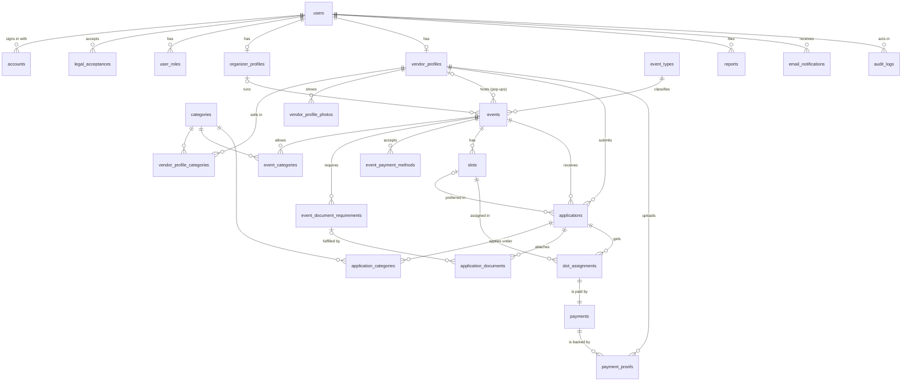
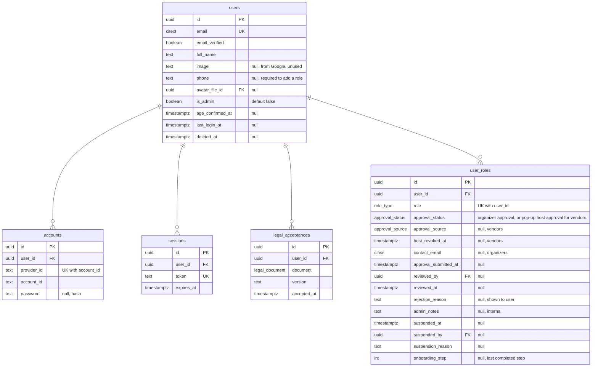
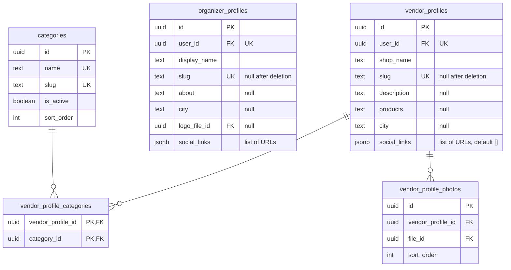
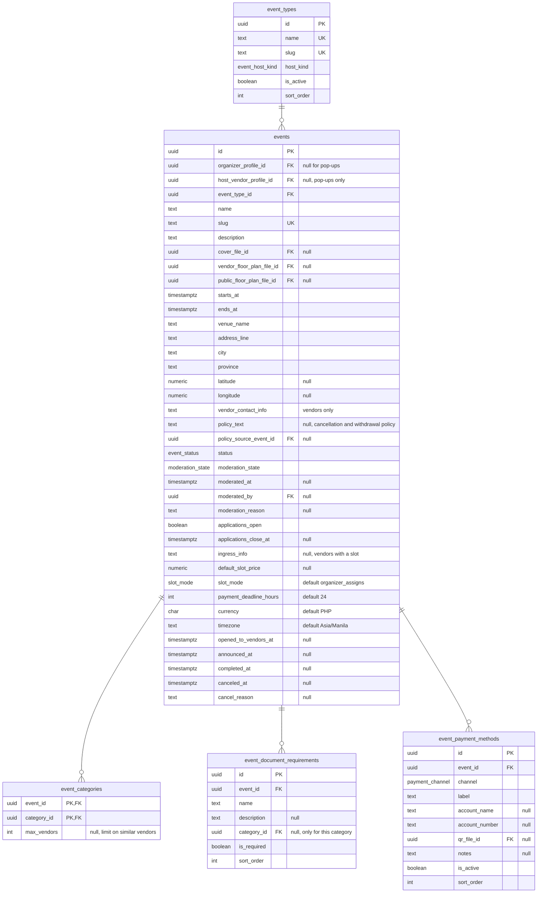
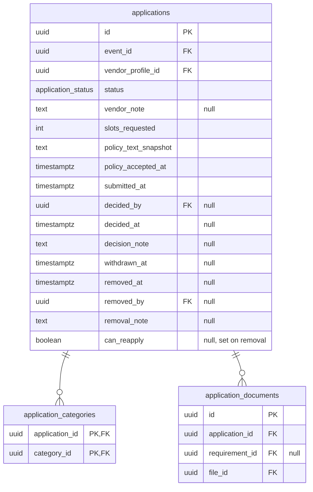
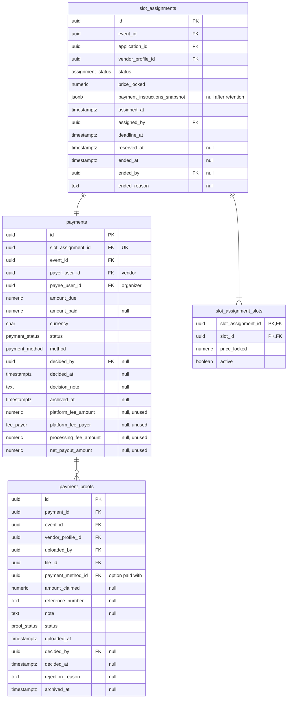

# Creavent MVP Data Model

**Status:** First draft. Logical model with PostgreSQL-style types. It follows the [Feature specification](feature-specification.md) and the [User flows](user-flows.md). If this file and the spec disagree, the spec wins.

Last updated: 2026-11-17

## Contents

1. [Conventions](#1-conventions)
2. [Decisions this model uses](#2-decisions-this-model-uses)
3. [ERD overview](#3-erd-overview)
4. [Enums (statuses and types)](#4-enums-statuses-and-types)
5. [Entities and attributes](#5-entities-and-attributes)
6. [Rules enforced by the data](#6-rules-enforced-by-the-data)
7. [Derived values](#7-derived-values)
8. [Retention and archiving](#8-retention-and-archiving)
9. [Decisions on questions this model raised](#9-decisions-on-questions-this-model-raised)

## 1. Conventions

- Every table has `id uuid` as its primary key, except join tables, which use a composite key.
- Every table has `created_at timestamptz` and, where rows change, `updated_at timestamptz`. These two columns are left out of the attribute tables below to keep them short.
- All times are stored as `timestamptz` (UTC). The app shows them in Asia/Manila.
- Money is `numeric(10,2)` in PHP. A `currency char(3)` column defaults to `PHP` so other currencies can be added later.
- Emails use `citext` so matching ignores case.
- Status columns use PostgreSQL enums (section 4).
- Rows that people may need as records are not hard-deleted. They change status (for example, a released assignment) or get `deleted_at` / `archived_at`.
- Key: **PK** primary key, **FK** foreign key, **UK** unique, **null** = optional.

## 2. Decisions this model uses

Agreed on 2026-11-11, and simplified for the MVP on 2026-11-12 (spec §9).

| Topic | Decision | Where in the model |
|---|---|---|
| Product categories | One platform-wide list, set in seed data. Vendors, events, and applications pick from it. | `categories` |
| Event types | One platform-wide list, set in seed data (Flea market, Bazaar, Pop-up). Each event has one. A table rather than an enum, because the list is managed in seed data like `categories`, can be marked inactive, and adding a type needs no enum migration. Each type says who hosts it: Pop-up is for vendors, the others for organizers (added 2026-11-17). | `event_types`, `event_types.host_kind`, `events.event_type_id` |
| Pop-up events | A pop-up is a row in `events` hosted by a vendor instead of an organizer, so the listing, event page, search, jobs, reports, and hiding work unchanged. Columns a pop-up doesn't use stay null (spec §4.7, decided 2026-11-17). | `events.host_vendor_profile_id` |
| Pop-up host approval | Lives on the vendor's role row, in the same columns as organizer approval, plus how it was granted and whether it was ever revoked. The links reviewed are the vendor profile's social links. | `user_roles.approval_*`, `user_roles.approval_source`, `user_roles.host_revoked_at` |
| Public vendor page | Every vendor has a public page at `/vendors/<slug>`. It shows profile content and two lists worked out from slot assignments. Phone, email, applications, documents, and payments are never shown. | `vendor_profiles.slug`, `vendor_profiles.social_links`, section 7 |
| One assignment per vendor | A vendor has at most one active assignment per event. It can cover several slots, up to the event's limit (decisions P2, P3), with one payment, so each proof belongs to exactly one payment. | partial UK on `slot_assignments`, `slot_assignment_slots`, `payment_proofs.payment_id` |
| Cash or payment without proof | The organizer can approve a payment without a proof image, with a note (for example, cash on site). | `payments.method`, `payments.decision_note` |
| Event policy | Free text, one per event, so it is a column on `events` rather than its own table. The text the vendor accepted is copied onto their application. | `events.policy_text`, `applications.policy_text_snapshot` |
| Roles | No attendee accounts. Only vendor and organizer are stored as roles. Admins are a flag on the user. | `user_roles`, `users.is_admin` |
| Organizer approval | No identity documents. The approval status and review live on the organizer's role row. The links reviewed are the profile's social links. | `user_roles.approval_*`, `organizer_profiles.social_links` |
| Slots | A plain list per event, with an optional section for grouping. Filled by organizer assignment. When the event allows it, a vendor states a preferred slot when applying, which holds nothing. | `slots`, `slot_assignments`, `events.slot_mode`, `applications.preferred_slot_id` |
| Floor plans | Two optional images on the event. | `events.vendor_floor_plan_file_id`, `events.public_floor_plan_file_id` |
| Slot status | Not stored on the slot. It is worked out from the slot's active assignment, so it can never disagree with it. | `slot_assignments`, view in section 7 |
| Settings | Retention, deadlines, minimum age, support email, and terms versions are configuration values, not a table. | Section 5.11 |

## 3. ERD overview

The overview shows entities and relationships only. Each area in section 5 has its own diagram with attributes. `files` is referenced by many tables and is left out of the overview to keep it readable.

## 4. Enums (statuses and types)

| Enum | Values | Spec |
|---|---|---|
| `role_type` | `vendor`, `organizer` | §1 |
| `approval_status` | `not_submitted`, `pending_review`, `approved`, `rejected` | §2.1, §4.7 |
| `approval_source` | `reviewed`, `earned` | §4.7 |
| `event_host_kind` | `organizer`, `vendor` | §3.1, §4.7 |
| `legal_document` | `terms`, `privacy` | §1 |
| `file_purpose` | `payment_proof`, `payment_qr`, `application_document`, `event_cover`, `vendor_floor_plan`, `public_floor_plan`, `vendor_photo`, `organizer_logo`, `avatar` | §6.5, §6.7, §11.1 |
| `file_status` | `pending`, `ready` | §11.3 |
| `event_status` | `draft`, `open_to_vendors`, `announced`, `completed`, `canceled` | §3.1 |
| `slot_mode` | `organizer_assigns`, `vendor_preference` | §3.4 |
| `moderation_state` | `visible`, `hidden` | §2 |
| `payment_channel` | `gcash`, `maya`, `bank`, `other` | §6.1 |
| `application_status` | `submitted`, `approved`, `declined`, `removed`, `withdrawn` | §4.2 |
| `assignment_status` | `assigned`, `reserved`, `released`, `removed`, `canceled` | §5, §6.6 |
| `payment_status` | `pending`, `submitted`, `approved`, `rejected` | §6.4 |
| `payment_method` | `proof_upload`, `cash`, `other` | §6.3 |
| `proof_status` | `submitted`, `approved`, `rejected` | §6.3 |
| `fee_payer` | `vendor`, `organizer` (unused in the MVP) | Revenue model §7 |
| `report_target` | `user`, `event` | §7 |
| `report_source` | `report_button`, `support_email` | §2.2 |
| `report_reason` | `fake_account`, `fake_or_misleading_event`, `scam`, `inappropriate_content`, `other` | §2.2 |
| `report_status` | `open`, `dismissed`, `actioned` | §2 |
| `report_action` | `none`, `event_hidden`, `user_suspended`, `host_approval_revoked`, `other` | §2.2, §4.7 |
| `email_status` | `queued`, `sent`, `failed` | §8.1 |
| `notification_type` | See section 5.11 | §8.1 |

**Assignment status meanings.** `assigned`: the organizer assigned the slot, payment not yet approved. `reserved`: payment approved. The rest are end states: `released` (vendor let it go), `removed` (organizer removed the vendor), `canceled` (event canceled). Only `assigned` and `reserved` are **active**.

## 5. Entities and attributes

### 5.1 Accounts and roles

**users**: one login per person (spec §1). This is also Better Auth's user table: Better Auth reads and writes `id`, `email`, `email_verified`, `full_name` (its `name`), `image`, `created_at`, and `updated_at`, and the other columns are ours (decided 2026-11-13, see "Auth library tables" below).

| Attribute | Type | Notes |
|---|---|---|
| id | uuid PK | |
| email | citext UK | Verified at signup. Signing in with Google using the same email opens the same account. If `email_verified` is still false, Google sign-in sets it and removes the password (spec §1). |
| email_verified | boolean | False until the email is confirmed. A boolean because Better Auth needs one. |
| image | text null | The Google profile picture address, set by Better Auth. Not shown in the MVP: the picture people see is `avatar_file_id`. |
| full_name | text | |
| phone | text null | Mobile number. Required for either role, and asked in onboarding (spec §1.1) (app check). Shown to organizers on applications, never on a public page. |
| avatar_file_id | uuid FK → files null | The avatar or logo asked for in vendor onboarding. Shown on the public vendor page. |
| is_admin | boolean | Default false. Set by the Creavent team only, never by signup. |
| age_confirmed_at | timestamptz null | When the user confirmed they meet the minimum age (configuration value `minimum_age`). Set at signup with email and password. A Google signup has no form, so it is null until the user confirms on `/account/legal`, which they see before any other page. |
| last_login_at | timestamptz null | |
| deleted_at | timestamptz null | The team deleted the account on the user's request. See below. |

**Deleting an account.** There is no self-serve option in the MVP (spec §1). The user emails support, and the team runs a documented deletion script:

- `email`, `full_name`, `phone`, `avatar_file_id`, `image` are cleared or replaced with placeholders ("Deleted user"). `accounts` and `sessions` rows are deleted. Profile photos are deleted. On the vendor and organizer profiles, `social_links` is cleared and `slug` is set to null, so the public page stops working. The profile rows are kept as empty shells (names and text cleared), because applications, assignments, and events point to them, like the `users` row.
- The `users` row is kept as an empty shell, because applications, payments, reports, and audit logs point to it.
- Reports, audit logs, and legal acceptances are kept. Payment records and application documents follow the normal 90-day rule (section 8).
- Not done while the user has an active slot assignment, runs an event that is `open_to_vendors` or `announced`, or hosts an `announced` pop-up that hasn't ended. Pending applications are withdrawn. The vendor's pop-up drafts are deleted, and past or canceled pop-ups are kept, like an organizer's events.
- `email` is a UK, so a deleted account's email is replaced with a placeholder. The person can sign up again with the same email as a brand-new account.

**Auth library tables.** Better Auth ([Architecture §4.2](architecture.md#42-auth-library)) keeps three tables of its own next to `users`. Their columns follow Better Auth's schema and are not listed here, except the ones the app reads. They replace the `auth_identities` table and `auth_provider` enum of earlier drafts.

| Table | What it holds |
|---|---|
| accounts | How a user signs in, one row per method. `provider_id` is `credential` (email and password, with the password hash in `password`) or `google` (with the Google account ID in `account_id`). UK (`provider_id`, `account_id`). Google sign-in removes the `credential` row of an account whose email was never verified (spec §1). |
| sessions | One row per signed-in browser, with the cookie's token. Checked on every request, so a deleted row signs the browser out. |
| verifications | Email verification and password reset tokens, with their expiry. |
| sign_in_attempts | One row per sign-in try with a password (`email`, `created_at`), for the per-email lockout (architecture §4.1). Rows older than the window are deleted. Not part of Better Auth. |

**legal_acceptances**: each time a user accepts a version of the terms of use or the privacy notice (spec §1). Rows are never updated or deleted, so the record shows who accepted which wording and when. Kept after account deletion, like audit logs.

| Attribute | Type | Notes |
|---|---|---|
| id | uuid PK | |
| user_id | uuid FK → users | |
| document | legal_document | |
| version | text | For example, `2026-11-12`. Matches the `terms_version` or `privacy_version` configuration value at the time. |
| accepted_at | timestamptz | |

A user whose latest acceptance is older than the current version is asked to accept the new one before continuing.

**user_roles**: the vendor and organizer roles a user has added, with approval and suspension (spec §1, §2.1). On the organizer row, approval is organizer approval. On the vendor row, it is pop-up host approval (spec §4.7, added 2026-11-17). Both use the same columns and the same admin queue.

| Attribute | Type | Notes |
|---|---|---|
| id | uuid PK | |
| user_id | uuid FK → users | UK with `role`: one row per role per user. |
| role | role_type | |
| approval_status | approval_status | Starts at `not_submitted` for both roles. For organizers, it gates opening events to vendors. For vendors, it is pop-up host approval and gates announcing pop-ups. Applying to events never needs it. Existing vendor rows are set to `not_submitted` by the migration that adds pop-ups. |
| approval_source | approval_source null | Vendors only. `reviewed` when an admin approved the host request, `earned` when the vendor was approved automatically for a reserved slot at a completed event (spec §4.7). Null until approved. |
| host_revoked_at | timestamptz null | Vendors only. Set when an admin revokes host approval. Never cleared: once set, the earned route no longer applies, and the vendor can only be approved through review. |
| contact_email | citext null | Required when an organizer requests approval. Not used for host approval. |
| approval_submitted_at | timestamptz null | When the organizer or host last requested approval. Null for an earned approval. |
| reviewed_by | uuid FK → users null | The admin. |
| reviewed_at | timestamptz null | |
| rejection_reason | text null | Shown to the organizer or vendor. Also holds the reason when host approval is revoked. Cleared on resubmission. |
| reviewed_links | jsonb null | The organizer's or host's links at the admin's last decision (for an earned host approval, the profile's links at that moment). Adding a link that isn't here sends an approved organizer or host back to review (spec §2.1, §4.7). |
| admin_notes | text null | Internal only. |
| suspended_at | timestamptz null | Not null = suspended. Suspension is per role: a suspended vendor role cannot apply or manage slots, and a suspended organizer role cannot manage events or applications. The other role keeps working. |
| suspended_by | uuid FK → users null | The admin. |
| suspension_reason | text null | Shown to the user in the app (spec §2.1). |
| onboarding_step | int null | The last onboarding step the user completed for this role (1 to 4). Null before the first step. The fields of each step are saved as they are entered (spec §1.1). |

A resubmission clears `rejection_reason` and keeps `reviewed_at` until the next decision, which overwrites the review columns. Each admin decision is also written to `audit_logs`, which keeps the history. An earned host approval sets `approval_status` `approved` and `approval_source` `earned`, leaves `reviewed_by` null, and writes no audit row, because no admin acted.

### 5.2 Files

One table for every upload, so access rules and retention live in one place. Files are stored in Cloudflare R2 (spec §11.2). The purpose decides which bucket a file is in: `event_cover`, `vendor_floor_plan`, `public_floor_plan`, `organizer_logo`, `avatar`, and `vendor_photo` go in the public bucket, and the rest go in the private bucket. No column stores this, because it follows from the purpose.

| Attribute | Type | Notes |
|---|---|---|
| id | uuid PK | Random (v4), because it is part of the file's path and must not be guessable. |
| uploaded_by | uuid FK → users | |
| purpose | file_purpose | Decides the bucket, who can view it (section 6.6), and the stored size (spec §11.5). |
| status | file_status | `pending` until the upload is checked and processed, then `ready`. Only `ready` files can be attached (section 6.10). |
| storage_key | text UK | The one stored object: `<purpose>/<id>.webp` for images, `<purpose>/<id>.pdf` for PDFs. Set at the Ask step, because the declared type decides it and the Complete step refuses a file whose real type differs. |
| mime_type | text | Type of the stored file, not of the upload: `image/webp` or `application/pdf`. |
| size_bytes | bigint | |
| width, height | int null | Pixel size of the stored image. Null for PDFs. |
| delete_after | timestamptz null | Set for payment proofs, QR images, and application documents (section 8). |
| deleted_at | timestamptz null | Set when a file is removed or replaced (for example, an old vendor photo or cover). The cleanup job deletes its object and then the row (section 8). Files with a retention period are deleted outright, row included, by the retention job. |

The upload lands first in `incoming/<id>` in the private bucket. The Complete step (spec §11.3) writes the final object and deletes that copy. A `pending` row older than 24 hours is deleted by the cleanup job.

### 5.3 Profiles and categories

**categories**: the platform-wide product category list. The initial list ships as a migration, because every environment needs it: Preloved clothing, Vintage, Handmade and crafts, Food and drinks, Plants, Books and toys, and Other (spec §4.1). Set in seed data and changed by a new seed or migration. A category is never deleted, only made inactive, because old events and applications point to it.

| Attribute | Type | Notes |
|---|---|---|
| id | uuid PK | |
| name | text UK | |
| slug | text UK | |
| is_active | boolean | Inactive categories can't be picked for new profiles or events. |
| sort_order | int | |

**organizer_profiles**: the public face of an organizer: the organizer page, the name on event pages, and the "Approved by Creavent" badge (spec §7.1). One per user.

| Attribute | Type | Notes |
|---|---|---|
| id | uuid PK | |
| user_id | uuid FK → users, UK | |
| display_name | text | |
| slug | text UK null | For the organizer page link, `/organizers/<slug>`. Generated from the display name and editable (onboarding step 2). Null after the account is deleted. Slug rules are in spec §7.2. An old slug redirects to the new one. |
| about | text null | |
| city | text null | Where they usually hold events. |
| logo_file_id | uuid FK → files null | |
| social_links | jsonb | List of URLs: social media pages and past event posts. Default `[]`. At least one is required to request approval. These are the links the admin reviews, and they are shown on the organizer page. |

The badge comes from `user_roles` (role `organizer`, `approval_status` `approved`, not suspended). "Joined" on the organizer page is the profile's `created_at`. A deleted organizer's page is not shown.

**vendor_profiles**: one per user (spec §4.1). It feeds the public vendor page (spec §7.2), and organizers see it when reviewing applications. The vendor's avatar is `users.avatar_file_id`. The phone number and email live on `users` and are never shown on the page.

| Attribute | Type | Notes |
|---|---|---|
| id | uuid PK | |
| user_id | uuid FK → users, UK | |
| shop_name | text | Shown on the accepted-vendor list and the vendor page. |
| slug | text UK null | For the vendor page link, `/vendors/<slug>`. Generated from `shop_name` and editable. Null after the account is deleted. Slug rules are in spec §7.2. An old slug redirects to the new one. |
| description | text null | The "about your shop" text, up to 300 characters. Shown on the vendor page. |
| products | text null | Free text about what they sell. Shown on the vendor page. |
| city | text null | Shown on the vendor page. Optional. Edited on the profile page, not asked in onboarding. |
| social_links | jsonb | List of URLs. Default `[]`, optional. Shown on the vendor page. Cleared when the account is deleted. Mirrors `organizer_profiles.social_links`. At least one is required to request pop-up host approval, and these are the links the admin reviews (spec §4.7). |

"Joined" on the vendor page is the profile's `created_at`. The page is not shown while the vendor's `user_roles` row is suspended or the account is deleted. Changing `shop_name` sends an approved host back to `pending_review` (spec §4.7).

**vendor_profile_categories**: the categories a vendor sells in. Composite PK (`vendor_profile_id`, `category_id`).

**vendor_profile_photos**: `id`, `vendor_profile_id` FK, `file_id` FK → files, `sort_order`. At most 8 per profile (section 6.11). The photos are public (spec §7.2).

### 5.4 Events

**event_types**: the platform-wide list of event types (spec §3.1). The seed is Flea market and Bazaar (`host_kind` `organizer`) and Pop-up (`host_kind` `vendor`). Set in seed data and changed by a new seed or migration, with no admin page. A type is never deleted, only made inactive, because old events point to it.

| Attribute | Type | Notes |
|---|---|---|
| id | uuid PK | |
| name | text UK | For example, "Flea market". |
| slug | text UK | For the attendee filter. |
| host_kind | event_host_kind | Who can host this type. Organizers pick only `organizer` types on the Details tab. Pop-ups always use the one `vendor` type. Added 2026-11-17. |
| is_active | boolean | Inactive types can't be picked for new events or shown as a filter. |
| sort_order | int | |

**events** (spec §3.1). A draft starts from a name and a type (decided 2026-11-14), so the description, dates, venue, and contact columns are null until the organizer fills them. The "Open to vendors" checklist requires them before opening.

A **pop-up** (spec §4.7) is an event with `host_vendor_profile_id` set and `organizer_profile_id` null. It uses the name, slug, description, cover, dates, venue, status, moderation, announce, complete, and cancel columns. Every vendor and slot column (`vendor_floor_plan_file_id`, `public_floor_plan_file_id`, `vendor_contact_info`, `policy_text`, `policy_source_event_id`, `applications_open` (always false), `applications_close_at`, `ingress_info`, `default_slot_price`, `slot_mode`, `max_slots_per_vendor`, `payment_deadline_hours`, `opened_to_vendors_at`) keeps its default or stays null, and a pop-up has no rows in `event_categories`, `event_document_requirements`, `event_payment_methods`, `slots`, or `applications`. Its categories on the page come from the host's `vendor_profile_categories`.

| Attribute | Type | Notes |
|---|---|---|
| id | uuid PK | |
| organizer_profile_id | uuid FK → organizer_profiles null | The organizer running the event. Null for a pop-up. |
| host_vendor_profile_id | uuid FK → vendor_profiles null | The vendor hosting a pop-up. Null for organizer events. Exactly one of the two is set (rule 6.14). Added 2026-11-17. |
| event_type_id | uuid FK → event_types | Required. The event setup form pre-selects Flea market. Drives the type tag and the attendee type filter (spec §7.3). Its `host_kind` must match the host column that is set (rule 6.15). |
| name | text | |
| slug | text UK | For the shareable event link. |
| description | text | |
| cover_file_id | uuid FK → files null | Required before opening to vendors (spec §3.1). |
| vendor_floor_plan_file_id | uuid FK → files null | Layout with empty slots. Shown to signed-in vendors while the event is open to vendors or announced (spec §3.4). |
| public_floor_plan_file_id | uuid FK → files null | Layout with vendors placed. Shown to attendees once the event is announced. |
| starts_at, ends_at | timestamptz | `starts_at` is the opening of the first day, and `ends_at` is the closing of the last day. The event runs every day in between, with the same hours (the time of day of each), so no other columns are needed (spec §3.1.1). `starts_at` caps every payment deadline. |
| venue_name, address_line, city, province | text | `city` drives the attendee location filter (Davao City first). |
| latitude, longitude | numeric(9,6) null | For a map later. |
| vendor_contact_info | text | Shown to signed-in vendors, never to attendees. |
| policy_text | text null | The event's cancellation and withdrawal policy (spec §3.7). Copied from the organizer's most recent event when the draft is created. Null on a first event until the organizer saves it. Required before opening to vendors. |
| policy_source_event_id | uuid FK → events null | The event the policy was copied from, so the Policy tab can say "Copied from your last event, …" while the text is unchanged. Added 2026-11-14. |
| status | event_status | `draft` → `open_to_vendors` → `announced` → `completed`, or `canceled`. A pop-up goes `draft` → `announced` and is never `open_to_vendors` (rule 6.14). |
| moderation_state | moderation_state | `visible` by default. `hidden` = an admin hid it for breaking rules or because the organizer was suspended (spec §2.1), or, for a pop-up, it was hidden automatically when the host's vendor role was suspended or host approval was revoked (spec §4.7). |
| moderated_at, moderated_by, moderation_reason | timestamptz / uuid FK → users / text, all null | Who hid it and why. An automatic hide records the admin who suspended or revoked, and the same reason. |
| applications_open | boolean | The organizer opens and closes applications (spec §3.3). Default false. |
| applications_close_at | timestamptz null | Optional. After this time no new applications are accepted, even if `applications_open` is true. No later than `starts_at`. |
| ingress_info | text null | Optional setup details for vendors, for example "From 3 PM, Gate 2". Shown to vendors with an active assignment. |
| default_slot_price | numeric(10,2) null | "One price for all slots". A slot's own `price` overrides it. |
| slot_mode | slot_mode | Default `organizer_assigns` ("I assign slots"). `vendor_preference` = vendors may pick a preferred slot when applying (spec §3.4). Can change at any time. Preferences already sent are kept. |
| max_slots_per_vendor | int | Default 1, check 1 to 10. How many slots one vendor can ask for and hold (decision P2). |
| payment_deadline_hours | int | Default 24. |
| currency | char(3) | Default `PHP`. |
| timezone | text | Default `Asia/Manila`. |
| opened_to_vendors_at, announced_at, completed_at, canceled_at | timestamptz null | When each status change happened. |
| cancel_reason | text null | |

**event_categories**: the allowed product categories for an event, and the limit on similar vendors (spec §3.2). Composite PK (`event_id`, `category_id`).

| Attribute | Type | Notes |
|---|---|---|
| event_id | uuid FK → events | |
| category_id | uuid FK → categories | |
| max_vendors | int null | For the "Food: 4 of 5 accepted" counter. A guide only. The system never auto-rejects. |

**event_document_requirements**: permits or documents vendors must upload when applying (spec §3.2). Shown only to signed-in vendors.

| Attribute | Type | Notes |
|---|---|---|
| id | uuid PK | |
| event_id | uuid FK → events | |
| name | text | For example, "Sanitary permit". |
| description | text null | |
| category_id | uuid FK → categories null | If set, only vendors applying under this category must upload it (for example, food vendors). |
| is_required | boolean | Default true. |
| sort_order | int | |

**event_payment_methods**: the organizer's payment options (spec §6.1). Any channel. Vendors pick one when they upload proof. The snapshot on each assignment keeps each option's `id`.

| Attribute | Type | Notes |
|---|---|---|
| id | uuid PK | |
| event_id | uuid FK → events | |
| channel | payment_channel | |
| label | text | For example, "GCash, Maria". Made from the channel and account name when the option is saved. |
| account_name, account_number | text null | |
| qr_file_id | uuid FK → files null | QR code image. |
| notes | text null | |
| is_active | boolean | Turn off instead of deleting, because existing assignments may point to it in their snapshot. |
| sort_order | int | |

### 5.5 Slots

**slots**: the event's slot list (spec §3.4). No positions or drawing data.

| Attribute | Type | Notes |
|---|---|---|
| id | uuid PK | |
| event_id | uuid FK → events | |
| label | text | Slot number. UK with `event_id` among slots that are not deleted, ignoring case (a partial unique index on `lower(label)`). |
| section | text null | Optional group, for example "Indoor" or "Outdoor". Vendors see slots grouped by section, or by label prefix when null (spec §3.4). |
| price | numeric(10,2) null | Null = use `events.default_slot_price`. |
| size_label | text null | Human-readable size, for example "2m x 2m". |
| note | text null | For example, "Near the entrance" or "Food row, with power". Shown to vendors and on the assignment. |
| sort_order | int | |
| set_aside_at | timestamptz null | Set when the organizer keeps the slot for their own booth or a sponsor (decision P1). Nobody can be assigned or prefer it. Not allowed while the slot has an active assignment. |
| set_aside_note | text null | The organizer's private note, for example "Sponsor booth". Null when not set aside. |
| deleted_at | timestamptz null | Soft delete, because past assignments point to the slot. Not allowed while the slot has an active assignment. |

Slot status (`open`, `assigned`, `reserved`, `set_aside`) is not stored here. See section 7.

### 5.6 Applications

**applications**: a vendor's request to join an event (spec §3.3, §4.2). Reapplying creates a new row, so history is kept.

| Attribute | Type | Notes |
|---|---|---|
| id | uuid PK | |
| event_id | uuid FK → events | |
| vendor_profile_id | uuid FK → vendor_profiles | |
| status | application_status | |
| vendor_note | text null | Optional message from the vendor. |
| slots_requested | int | Default 1, check 1 to 10. How many slots the vendor asked for, at most the event's `max_slots_per_vendor` when applying (decision P4). |

**application_preferred_slots**: the vendor's preferred slots (spec §4.3), at most `slots_requested`. PK (`application_id`, `slot_id`), `slot_id` FK → slots. Only kept when the event's `slot_mode` is `vendor_preference`. Each must be a slot of the same event that is open (no active assignment, not set aside) when saved (app check). Holds nothing: several applications can prefer the same slot. The vendor can change them until a slot is assigned (decided 2026-11-15).
| policy_text_snapshot | text | The event policy at the time of applying. Applying means the vendor accepted it. |
| policy_accepted_at | timestamptz | |
| submitted_at | timestamptz | |
| decided_by, decided_at, decision_note | uuid FK → users / timestamptz / text, all null | Approve or decline, with an optional note. |
| withdrawn_at | timestamptz null | The vendor withdrew the application. Allowed while the status is `submitted` or `approved`. An active assignment that is still `assigned` is released with it; a `reserved` one blocks it, and the vendor contacts the organizer instead (decided 2026-11-15). A withdrawn vendor can apply again, like a declined one. The organizer gets an `application_withdrawn` email. |
| removed_at, removed_by, removal_note | timestamptz / uuid FK → users / text, all null | Set when the organizer removes the vendor. |
| can_reapply | boolean null | Set on removal. False blocks new applications from this vendor to this event. |

**application_categories**: the categories the vendor applies to sell under at this event. Drives the category counter. Each must be both one of the vendor's categories and one of the event's allowed categories. Composite PK.

**application_documents**: permits and documents uploaded with the application.

| Attribute | Type | Notes |
|---|---|---|
| id | uuid PK | |
| application_id | uuid FK → applications | |
| requirement_id | uuid FK → event_document_requirements null | Which requirement it meets. Null for extra documents. |
| file_id | uuid FK → files | Purpose `application_document`. Deleted 90 days after the event (section 8). |

### 5.7 Slot assignments and payments

**slot_assignments**: one vendor's claim on their slots at an event, from assignment until it ends (spec §5, §6, decision P3). A slot keeps every past assignment as history. Each slot is in at most one active assignment (`assigned` or `reserved`).

| Attribute | Type | Notes |
|---|---|---|
| id | uuid PK | |
| event_id | uuid FK → events | For per-event queries and the one-assignment-per-vendor rule. |
| application_id | uuid FK → applications | Must be `approved`. |
| vendor_profile_id | uuid FK → vendor_profiles | |
| status | assignment_status | See section 4. |
| price_locked | numeric(10,2) | The sum of the slot prices copied at assignment (spec §6.1). |
| payment_instructions_snapshot | jsonb null | The active `event_payment_methods` copied at assignment: channel, label, account name and number, QR file id, notes. Set to null by the retention job (section 8). |
| assigned_at | timestamptz | |
| assigned_by | uuid FK → users | The organizer. |
| deadline_at | timestamptz | When payment is due: `least(assigned_at + payment_deadline_hours, event starts_at)`. Shown to both sides. Not enforced: nothing expires (spec §6.4). |
| reserved_at | timestamptz null | When payment was approved. |
| ended_at, ended_by, ended_reason | timestamptz / uuid FK → users / text, null | Set when the assignment moves to an end state. |

**slot_assignment_slots**: the slots one assignment covers (decision P3). `price_locked` is the slot's price copied at assignment. `active` is true while the assignment is `assigned` or `reserved`, and set to false in the same transaction that ends it, so all of a vendor's slots open together (decision P6) and a partial unique index can keep each slot in one active assignment (§6.3).

**payments**: what is owed for one assignment, and its status. One per assignment (spec §6.7, Revenue model §7).

| Attribute | Type | Notes |
|---|---|---|
| id | uuid PK | |
| slot_assignment_id | uuid FK → slot_assignments, UK | |
| event_id | uuid FK → events | |
| payer_user_id | uuid FK → users | The vendor. |
| payee_user_id | uuid FK → users | The organizer. |
| amount_due | numeric(10,2) | Equals `slot_assignments.price_locked`. Full price only (no deposits). |
| amount_paid | numeric(10,2) null | Optional, entered by the organizer when approving. |
| currency | char(3) | Default `PHP`. |
| status | payment_status | `pending` → `submitted` → `approved` / `rejected`. A rejected payment goes back to `submitted` when the vendor uploads new proof. |
| method | payment_method | `proof_upload` by default. `cash` or `other` when the organizer approves without a proof. |
| decided_by, decided_at | uuid FK → users / timestamptz, null | |
| decision_note | text null | Required when approving without a proof, for example "Paid cash at the office". |
| archived_at | timestamptz null | Set when the vendor is removed or the event is canceled. Archived records are read-only. |
| platform_fee_amount, platform_fee_payer, processing_fee_amount, net_payout_amount | null | Designed but unused in the MVP, so online payments can be added later. |

**payment_proofs**: one uploaded screenshot, for one payment.

| Attribute | Type | Notes |
|---|---|---|
| id | uuid PK | |
| payment_id | uuid FK → payments | The payment this proof backs. |
| event_id | uuid FK → events | |
| vendor_profile_id | uuid FK → vendor_profiles | |
| uploaded_by | uuid FK → users | The vendor. |
| file_id | uuid FK → files | Purpose `payment_proof`. |
| payment_method_id | uuid FK → event_payment_methods | The payment option the vendor says they paid with (spec §6.2). Required. Must be one of the options in the assignment's `payment_instructions_snapshot`. Methods are never deleted, only made inactive, so the link stays valid. |
| amount_claimed | numeric(10,2) null | The amount the vendor says they sent. The form pre-fills it with the amount due. |
| reference_number | text null | Optional GCash or bank reference, shown to the organizer for checking. |
| note | text null | |
| status | proof_status | The organizer approves or rejects the proof. |
| uploaded_at | timestamptz | |
| decided_by, decided_at | uuid FK → users / timestamptz, null | |
| rejection_reason | text null | Required on reject, for example "Short by ₱100". |
| archived_at | timestamptz null | Same rule as payments. |

**How a proof moves the statuses**

| Action | payment_proofs | payments | slot_assignments |
|---|---|---|---|
| Vendor uploads proof | `submitted` | `submitted` | no change |
| Organizer approves | `approved` | `approved` | `reserved`, `reserved_at` set |
| Organizer rejects | `rejected` | `rejected` | no change. The vendor can upload new proof |
| Organizer approves without proof | no row | `approved`, method `cash` or `other` | `reserved` |
| Deadline passes | no change | no change | no change. Shown as overdue (section 7) |
| Organizer removes the vendor | `archived_at` set | `archived_at` set | `removed`, slot is open again |

A payment can have several proofs over time (a rejected one, then a new one).

### 5.8 Reports and moderation

**reports**: signed-in users report with the report button. Attendees use the support email, and an admin adds those emails as reports (spec §2.2).

| Attribute | Type | Notes |
|---|---|---|
| id | uuid PK | |
| number | int UK | Shown as a reference, for example RPT-0142. From a sequence. |
| source | report_source | `report_button` or `support_email`. |
| reporter_user_id | uuid FK → users null | Set for the report button. Null for support emails. |
| reporter_email | citext null | For support emails: the sender's address. |
| created_by | uuid FK → users null | For support emails: the admin who added it. |
| target_type | report_target | |
| target_user_id | uuid FK → users null | Set when `target_type` = `user`. |
| target_event_id | uuid FK → events null | Set when `target_type` = `event`. |
| reason | report_reason | |
| details | text null | |
| status | report_status | Default `open`. |
| action_taken | report_action null | |
| resolved_by, resolved_at | uuid FK → users / timestamptz, null | |
| resolution_note | text null | Internal note on what the admin checked and why. |

Check: exactly one target column is set, and it matches `target_type`. Partial unique indexes allow one `open` report per reporter and target (decision R3). Open reports with the same target are shown and resolved together.

Moderation actions are stored where they apply: `user_roles.suspended_*` for suspensions, `events.moderation_*` for hidden events, and `user_roles.approval_status`, `rejection_reason`, and `host_revoked_at` for a revoked host approval. Each is also written to `audit_logs`.

### 5.9 Email notifications

**email_notifications**: every email sent through Resend, written as an outbox row and sent by a job.

| Attribute | Type | Notes |
|---|---|---|
| id | uuid PK | |
| user_id | uuid FK → users null | |
| to_email | citext | The address at send time. |
| type | notification_type | See the list below. |
| event_id | uuid FK → events null | Added with the events table in Phase 2. |
| related_entity_type, related_entity_id | text / uuid, null | For example, `slot_assignment` and its id. |
| payload | jsonb | Values used in the template. |
| status | email_status | |
| error | text null | |
| sent_at | timestamptz null | |

`notification_type` values, one per row in spec §8.1, plus the account emails sent by the auth library: `email_verification`, `email_change_confirmation` (to the old address, approving an email change), `password_reset`, `organizer_approved`, `organizer_rejected`, `host_approved`, `host_rejected`, `host_approval_revoked` (added 2026-11-17), `application_submitted`, `application_withdrawn`, `application_approved`, `application_declined`, `slot_assigned`, `slot_released`, `proof_uploaded`, `payment_approved`, `payment_rejected`, `vendor_removed`, `event_changed`, `event_canceled`, `event_hidden` (added in Phase 5).

### 5.10 Audit log

**audit_logs**: append-only record of admin actions (spec §2), including each time an admin opens an application document or a proof of payment. Rows are never deleted. The one change ever made to them: the retention job blanks payment details (`changes` and `reason` on payment and proof rows, the price on assignment rows) with the rest of the event's payment records (decision R14).

| Attribute | Type | Notes |
|---|---|---|
| id | uuid PK | |
| actor_user_id | uuid FK → users | Who did it. |
| action | text | For example, `organizer_approval.approve`, `organizer_approval.reject`, `host_approval.approve`, `host_approval.reject`, `host_approval.revoke`, `application_document.view`, `payment_proof.view`, `user_role.suspend`, `event.hide`, `report.resolve`. |
| entity_type | text | |
| entity_id | uuid | |
| changes | jsonb null | Before and after values. |
| reason | text null | |
| created_at | timestamptz | |

### 5.11 Configuration

Platform values are configuration (environment variables with defaults in code), not a table. Changing one needs a deploy, not a code change.

| Key | Default | Notes |
|---|---|---|
| `proof_retention_days` | 90 | Payment records and application documents (section 8). Placeholder until the legal review. |
| `default_payment_deadline_hours` | 24 | Used when an event is created. |
| `example_policy_text` | | The example shown on the Policy tab of an organizer's first event (spec §3.7). Not saved until the organizer saves it. |
| `support_email` | | |
| `minimum_age` | 18 | Placeholder until the legal review. |
| `terms_version`, `privacy_version` | | For example, `2026-11-12`. |

## 6. Rules enforced by the data

Rules the database itself should guarantee. Other rules (for example, "an organizer must be approved to open an event") are checked by the app.

| # | Rule | How | Spec |
|---|---|---|---|
| 6.1 | A user has each role at most once. | UK `user_roles(user_id, role)` | §1 |
| 6.2 | Only one active application per vendor per event. | Partial UK `applications(event_id, vendor_profile_id) WHERE status IN ('submitted','approved')` | §3.3 |
| 6.3 | A slot belongs to one vendor at a time. | Partial UK `slot_assignment_slots(slot_id) WHERE active` | §5 |
| 6.4 | A vendor has one active assignment per event, covering at most `slots_requested` slots (app check). | Partial UK `slot_assignments(event_id, vendor_profile_id) WHERE status IN ('assigned','reserved')` | §5 |
| 6.5 | Assigned and reserved slots can't be deleted or renamed. | App check before editing `slots.label` or setting `deleted_at` while an active assignment exists. | §3.4 |
| 6.6 | Private files are private. | Files in the private bucket are readable only by these people. `payment_proof`: the uploader, the event's organizer, and admins. `payment_qr`: the event's organizer, vendors with an active assignment at that event, and admins. `application_document`: the applying vendor, the event's organizer, and admins. The API checks this on every read and serves the file through a signed URL that expires in 5 minutes. Public purposes are in the public bucket and open to anyone with the address. | §6.5, §11.1 |
| 6.7 | No payment deadline runs past the event start. | `deadline_at` is always set with `least(…, events.starts_at)`. | §6.1 |
| 6.8 | A hidden event takes no new applications, assignments, proofs, or approvals, and is not shown to the public. | App check on `events.moderation_state`. | §2 |
| 6.9 | Money amounts are never negative. | Check `amount_due >= 0`, `price >= 0`, and so on. | |
| 6.10 | Preferred slots belong to the application's event, are open (not assigned and not set aside) when saved, and are at most `slots_requested`. | App check on insert or change. Not rechecked later, because a preference holds nothing. | §4.3 |
| 6.10 | A file is attached only when it is ready, matches the place, and belongs to the person attaching it. | App check before setting any `*_file_id` or inserting into `vendor_profile_photos` or `application_documents`: `status = 'ready'`, the `purpose` fits (for example, `events.cover_file_id` takes only `event_cover`), and `uploaded_by` is the current user. | §11.3 |
| 6.11 | Upload limits per place hold (for example, 8 photos per vendor profile). | App check against the limits in the spec table, at the Ask step and again when attaching. | §11.1 |
| 6.12 | The applications close date is not after the event start. | Check `applications_close_at IS NULL OR applications_close_at <= starts_at`. | §3.3 |
| 6.13 | An event runs 1 to 7 days in a row, and closes later than it opens each day. | Check in Asia/Manila time: `ends_at::date - starts_at::date` between 0 and 6, and `ends_at::time > starts_at::time`. | §3.1.1 |
| 6.14 | An event has exactly one host, and a pop-up is never open to vendors. | Check `num_nonnulls(organizer_profile_id, host_vendor_profile_id) = 1`, and `host_vendor_profile_id IS NULL OR (status <> 'open_to_vendors' AND applications_open = false)`. | §4.7 |
| 6.15 | The event type matches the host. | App check on create and on a type change: an organizer event uses an `organizer` type, a pop-up the `vendor` type. | §3.1, §4.7 |
| 6.16 | A pop-up has no vendor-side rows. | App check: categories, requirements, payment methods, slots, and applications are refused for an event with `host_vendor_profile_id` set. | §4.7 |

**Useful indexes**

- `events(status, moderation_state, starts_at)` and `events(city, starts_at)` for the attendee listing and filters.
- `events(host_vendor_profile_id, starts_at) WHERE host_vendor_profile_id IS NOT NULL` for a host's pop-ups and the vendor page.
- `applications(event_id, status)` for the review list and counters.
- `slot_assignments(event_id, status)` for the organizer's vendor and slot view.
- `user_roles(approval_status, approval_submitted_at)` for the admin approval queue.
- `files(delete_after) WHERE deleted_at IS NULL` for the retention job.
- `files(created_at) WHERE status = 'pending'` and `files(deleted_at) WHERE deleted_at IS NOT NULL` for the cleanup job.

## 7. Derived values

Values worked out from other tables instead of being stored.

| Value | How it's worked out |
|---|---|
| **Slot status** | Active assignment with status `assigned` → `assigned`. Status `reserved` → `reserved`. No active assignment and `set_aside_at` set → `set_aside`. Otherwise `open`. Vendors see `set_aside` as taken. |
| **Preferred by** (per slot) | Applications with the slot in `application_preferred_slots`, `status` `submitted` or `approved`, and no active assignment. Shown to the organizer as "Preferred by 2". |
| **Overdue payment** | Active assignment with status `assigned`, payment `pending` or `rejected`, and `deadline_at` in the past. Shown to the organizer only. |
| **Accepted-vendor list** | Vendors with a `reserved` assignment at the event. Each name links to the vendor page. |
| **Vendor page: "Where they've sold"** | Events where the vendor has a `reserved` assignment, and the event `status` is `announced` or `completed` and `moderation_state` is `visible`. Never `draft` or `open_to_vendors`, and never an event canceled before it was announced. An assignment ends as `canceled` when its event is canceled, so events canceled after announcement are left out too. Plus pop-ups the vendor hosts (`host_vendor_profile_id`) with `status` `announced` or `completed` and `moderation_state` `visible` (spec §7.2). |
| **Vendor page: "Find them next at"** | Among the same events, the one with `status` `announced` and the earliest `starts_at` still ahead, with the slot `label`, or "Pop-up" for a pop-up. |
| **Vendor page: events sold at** | The number of events in "Where they've sold". |
| **Vendor page visible** | The vendor's `user_roles` row is not suspended, and the user is not deleted. |
| **Event days** | Every date from `starts_at` to `ends_at` (Asia/Manila), each open from the time of `starts_at` to the time of `ends_at`. Used for the calendar, the "Next 7 days" strip, weekend grouping, and date filters, where an event matches if any of its days does. |
| **Accepting applications** | `status` `open_to_vendors` or `announced`, `applications_open` true, `moderation_state` `visible`, and `applications_close_at` null or still ahead. |
| **Category spots left** (vendor events page and event page) | `event_categories.max_vendors` minus the count of `approved` applications in that category. Shown only when `max_vendors` is set. A guide only. |
| **Organizer dashboard counts** (per event) | Applications to review: `submitted` applications, with the oldest `submitted_at`. Proofs to check: `submitted` proofs, with the sum of `amount_due`. Overdue payments: see "Overdue payment". Approved vendors with no slot: see below, with the count of `open` slots. |
| **Vendor dashboard status** | From the latest application and its active assignment: `submitted`, `declined`, `withdrawn`, `removed` as stored; `approved` with no assignment = "Approved"; assignment `assigned` = "Slot assigned"; `reserved` = "Reserved". |
| **Admin: resubmission** | Organizer role with `approval_status` `pending_review` and `reviewed_at` set (an earlier review exists). |
| **Admin: waiting time** | Business days since `approval_submitted_at`, compared with the 2-day target. |
| **Slots at a glance** | Counts of `open`, `assigned`, and `reserved` slots (see "Slot status") and of overdue payments for the event. |
| **Category counter** ("Food: 4 of 5 accepted") | Count of `approved` applications with that category in `application_categories`, compared with `event_categories.max_vendors`. |
| **Approved vendors without a slot** | `approved` applications with no active assignment. |
| **"Approved by Creavent" badge** | Organizer's `user_roles` row has `approval_status` `approved` and `suspended_at` is null. On a pop-up and its listing card, the same test on the host's vendor row. |
| **Pop-up host history line** ("Joined Nov 2026 · Sold at 3 Creavent events") | The vendor profile's `created_at` and "Vendor page: events sold at". |
| **Earned host approval** | The vendor has a `reserved` assignment at an event with `status` `completed` and `moderation_state` `visible`, and `host_revoked_at` is null. Checked when the vendor opens Host a pop-up, and saved then (spec §4.7). |
| **Pop-up checklist** | Name, description, cover, dates, and venue set; the host's vendor row `approved` and not suspended; shop name, phone, and at least one category set. |
| **Admin: host request** | Vendor role with `approval_status` `pending_review`. Shown in the approvals queue tagged "Pop-up host". |
| **Event's "event date" for retention** | `events.ends_at`, or `canceled_at` if the event was canceled before it took place. |

**Scheduled jobs that use this model**

- **Mark completed:** move `announced` events to `completed` after `ends_at`. Pop-ups included.
- **Retention:** 90 days after each event, delete its payment records, proof images, QR images, and application documents (section 8).
- **Cleanup:** delete removed and abandoned uploads (section 8).

## 8. Retention and archiving

- **On removal or cancellation:** the vendor's `payments` and `payment_proofs` get `archived_at`. They become read-only, and the vendor, the organizer, and admins can still view and download them (spec §6.6).
- **90 days after the event:** `proof_retention_days` (90 by default) after the event date, the retention job permanently deletes:
  - the proof images in storage and their `files` rows
  - `payment_proofs`
  - `payments` (amounts, statuses, decisions)
  - the QR images in `event_payment_methods`, and `slot_assignments.payment_instructions_snapshot`, which is set to null
  - the application documents (permits) in storage, their `files` rows, and `application_documents`
  - the sent `email_notifications` rows that carried payment amounts, slots or account details for that event (decision R12)
  - the payment details in `audit_logs`: `changes` and `reason` on its payment and proof rows, and the price on its assignment rows; who acted, what and when stay (decision R14)

  The `slot_assignments` and `applications` rows themselves stay, as the record of who joined the event and had which slot. The job works from the events: an event's records go when its `ends_at`, or its `canceled_at` if it was canceled, is more than `proof_retention_days` ago (decision R6). It sets `deleted_at` on the files, and the cleanup job deletes the objects. `files.delete_after` is not used (changed 2026-11-17).
- **Cleanup job (daily, spec §11.7):** deletes the object and then the row for files with `deleted_at` older than 24 hours, and deletes `pending` files older than 24 hours. A removed file that a row still points to is kept, because its `ON DELETE SET NULL` keys would quietly empty a picture. A lifecycle rule on the private bucket's `incoming/` area also expires leftover uploads after 1 day, as a safety net. Replacing a cover, logo, avatar, floor plan, or photo sets `deleted_at` on the old file. Deleting an account sets it on the avatar.

> **Check with the lawyer (G2, G3):** permits can include health certificates, which may be sensitive personal information under the Philippine Data Privacy Act. Confirm that 90 days is the right period for them and for payment records.

## 9. Decisions on questions this model raised

Decided on 2026-11-11. Written into the [Feature specification](feature-specification.md) on 2026-11-12, and updated the same day when the MVP was simplified and when the docs were aligned with the UI mockup (`events.applications_close_at`, `events.ingress_info`, `slots.note`, `payment_proofs.reference_number`, report source and number, `event_hidden` email).

| # | Question | Decision | Where in the model |
|---|---|---|---|
| 1 | Keep payment rows after the 90-day image deletion? | No. Payment records are deleted with the images after 90 days, to save space. | Section 8 |
| 2 | How long to keep verification documents? | No longer applies. The MVP collects no identity documents. Application documents are deleted 90 days after the event. | Section 8 |
| 3 | Can a user delete their account? | Yes, by emailing support. The team deletes it by hand. No self-serve option in the MVP. | Section 5.1, "Deleting an account" |
| 4 | Can a vendor withdraw an application? | Yes, while it is still `submitted` (not yet approved or declined by the organizer). | Section 5.6, `withdrawn` status |
| 5 | Store a history of event date, time, and location changes? | No. Changes only send emails. | No table |
| 6 | Keep a history of organizer approval reviews? | No separate table. The latest review is on `user_roles`, and every decision is in `audit_logs`. | Section 5.1 |

No open items remain for this model, other than the lawyer check under section 8. The follow-up questions from the 2026-11-12 design decisions were decided the same day (see [Open questions](open-questions.md#j-public-pages-onboarding-and-event-types)).
